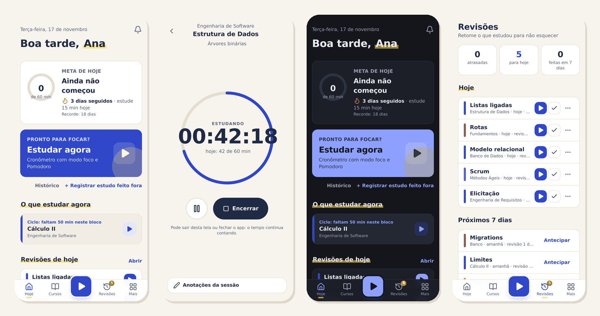
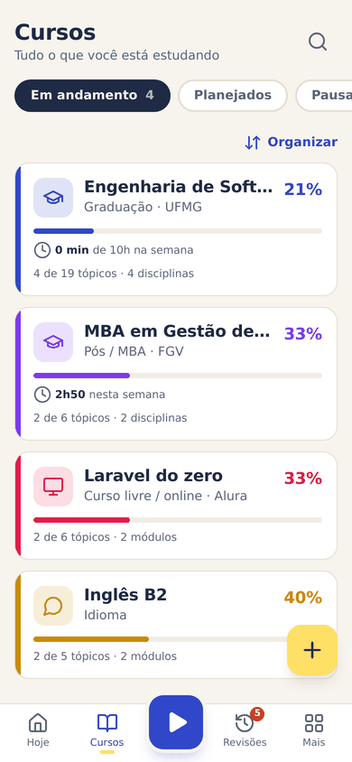
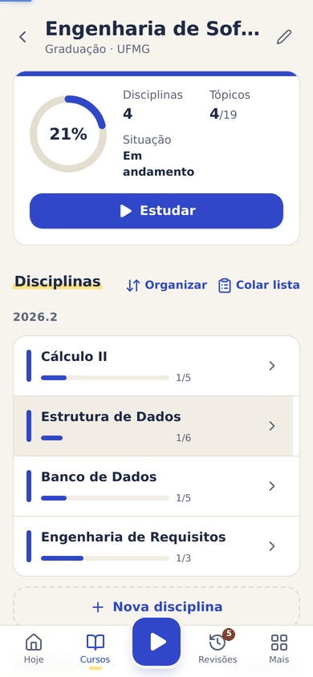
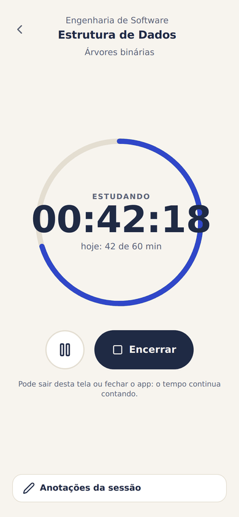
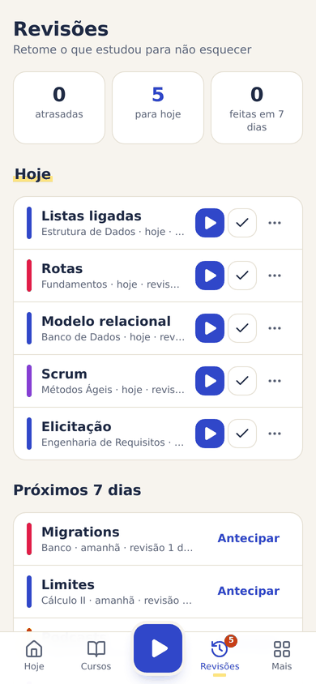
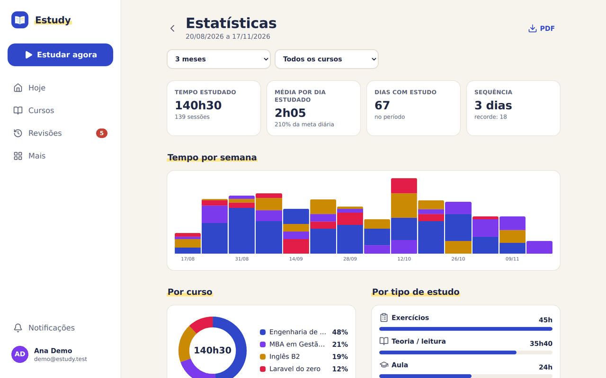
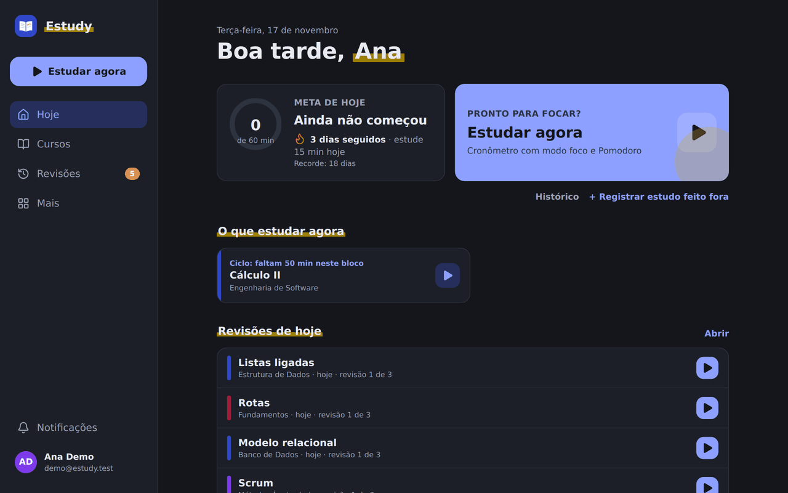

<p align="center">
  
</p>

<h1 align="center">Estudy</h1>

<p align="center">
  <strong>Seus estudos, do seu jeito.</strong><br>
  Cursos, cronômetro com modo foco, revisões espaçadas e metas — num app leve, instalável no celular.
</p>

<p align="center">
  
  
  
  
  
  
</p>

<p align="center"></p>

---

Para quem estuda **por conta própria**: graduação, pós, curso livre, extensão, idioma ou aquele livro que você quer terminar.
Nada de edital pronto — você cadastra seus cursos, disciplinas (ou módulos) e tópicos, e o Estudy cuida do resto:
quanto tempo você estudou, o que revisar hoje e o que estudar agora.

## ✨ Recursos

| | |
|---|---|
| 📚 **Cursos do seu jeito** | Cursos → disciplinas/módulos → tópicos. **Cole uma ementa ou sumário** e cada linha vira um tópico. |
| ⏱️ **Cronômetro e modo foco** | Tela cheia, **Pomodoro** com alarme e aviso por push mesmo com o celular bloqueado. O tempo fica no servidor: feche o app ou troque de aparelho e ele continua certo. |
| 🔁 **Revisões espaçadas** | Agendadas sozinhas (1, 7 e 30 dias, configurável); "lembrei bem / com dificuldade / esqueci" ajusta o intervalo. Nada nos seus dias de folga. |
| 🎯 **Metas e sequência** | Meta diária e semanal, sequência de dias e **"O que estudar agora"** (ciclo, metas, prazos e onde você parou). |
| 🔄 **Ciclo de estudos** | Rodízio de disciplinas por peso. Perdeu um dia? Continua de onde parou. |
| 📅 **Agenda e notas** | Provas e entregas com peso; média ponderada e **quanto falta tirar** para passar. |
| 📊 **Estatísticas** | Tempo por curso, tipo e semana, horário em que você rende mais, acertos, mapa de dificuldade — sem biblioteca de gráficos. |
| 🎓 **Formação e relatórios** | Histórico com carga horária e certificados; **PDFs** de estudos, boletim, progresso e formação. |
| 🔔 **Lembretes** | Push com lembrete diário, revisões do dia, provas na véspera e sequência em risco. |
| 📱 **PWA** | Instalável (Android/iOS), tema claro/escuro, backup/importação em JSON e CSV. |

## 📸 Telas

<p align="center">
  
  
  
  
</p>
<p align="center">
  
  
</p>

## 🛠️ Stack

Laravel 12 · PHP 8.4 · Livewire 3 + Alpine · Tailwind CSS 4 · SQLite (WAL) · Fortify · Web Push · dompdf (só PDFs) · Pest + Larastan.
Leve de propósito: ~3 kB de JS próprio (gzip), gráficos em SVG/CSS no Blade, ícones inline, sem Docker.

## 🚀 Rodando localmente

```bash
composer install && npm install
cp .env.example .env && php artisan key:generate
touch database/database.sqlite
php artisan migrate --seed     # demo@estudy.test / demo12345, com ~6 meses de dados
composer run dev               # http://localhost:8000
```

Antes de publicar: `php artisan test && ./vendor/bin/phpstan analyse --memory-limit=1G && ./vendor/bin/pint`

## 📦 Deploy

Hospedagem compartilhada (cPanel), sem Docker: `scripts/release.sh` roda testes e Larastan, gera o build e abre uma PR
para a branch `production`, mergeada sozinha; o cron aplica migrations, processa a fila e envia os avisos.
Detalhes em [`docs/go-live.md`](docs/go-live.md).

## 📖 Documentação

[Desenvolvimento](docs/desenvolvimento.md) · [Operação](docs/go-live.md) · [Plano](docs/plano-geral.md) · [Especificação](docs/especificacao.md) · [Design](docs/design.md) · [Pesquisa](docs/pesquisa-mercado.md) · [Etapas](docs/etapas) · [`CLAUDE.md`](CLAUDE.md)
